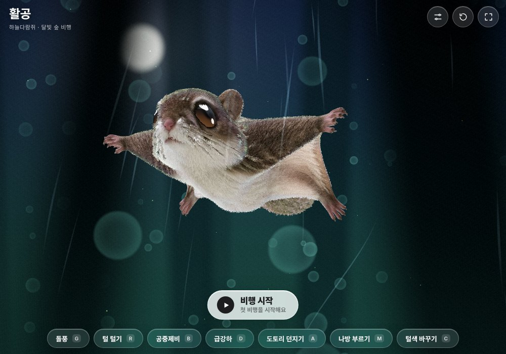

# 활공 · 날다람쥐

달빛 숲을 나는 하늘다람쥐 인터랙티브 3D 웹 작품이에요. 브라우저에서 바로 실행돼요.

**플레이:** https://i0kyung.github.io/flying-squirrel/

## 두 가지 화면

**메인 화면.** 상승기류를 타고 활공하는 다람쥐를 둘러보고 만져 볼 수 있어요.
- 드래그로 카메라 회전, 휠·핀치로 확대, 다람쥐를 탭하면 반응해요.
- 돌풍(G), 털 털기(R), 공중제비(B), 급강하(D), 도토리 던지기(A), 나방 부르기(M), 털색 바꾸기(C)
- 설정 패널에서 카메라, 톤, 시간대(달밤·새벽·한낮), 바람, 털색을 바꿀 수 있어요.

**비행 게임.** 나무줄기와 나뭇가지를 피해 숲을 날아요.
- PC: 마우스로 움직이고, 꾹 누르고 있으면 날개를 접어요. 방향키·WASD와 스페이스도 돼요.
- 폰: 드래그로 움직이고, 두 손가락이나 [접기] 버튼을 누르고 있으면 날개를 접어요.
- 좁은 틈은 날개를 접어야 지나갈 수 있어요. 빛나는 상승기류 고리를 통과하면 잠깐 무적이 돼요.
- 점수: 비행 거리 + 도토리 10점 + 아슬아슬 5점 + 상승기류 25점

## 만든 방식

- 라이브러리 없이 WebGL로 직접 렌더링했어요. 모델과 텍스처까지 `index.html` 한 파일에 들어 있어요.
- 다람쥐 모델은 Meshy AI로 만든 리깅 모델이고, 뼈대 45개를 코드로 움직여요.
- 털은 겹을 쌓는 방식(shell fur)으로 그리고, 비막은 바람에 부풀도록 따로 변형해요.

© 김민경 (i0kyung)
